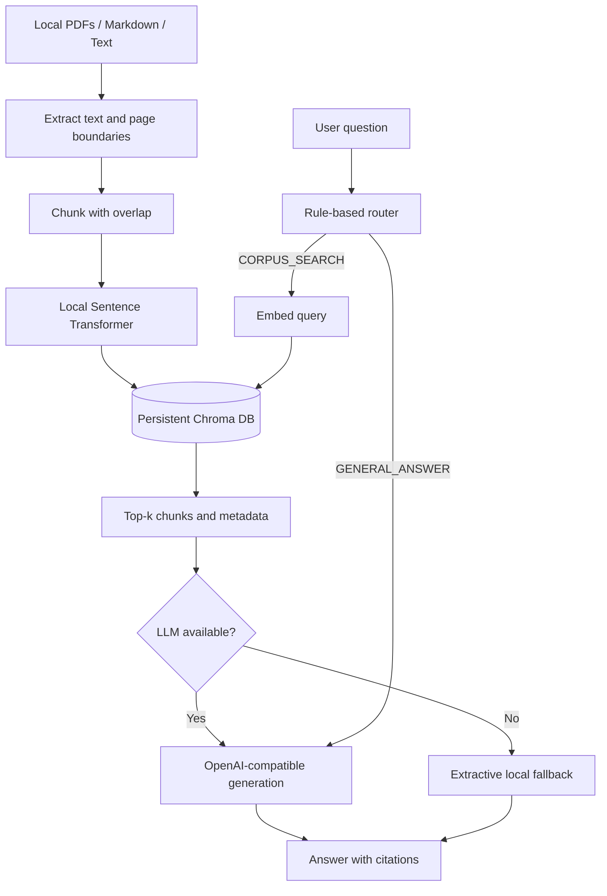
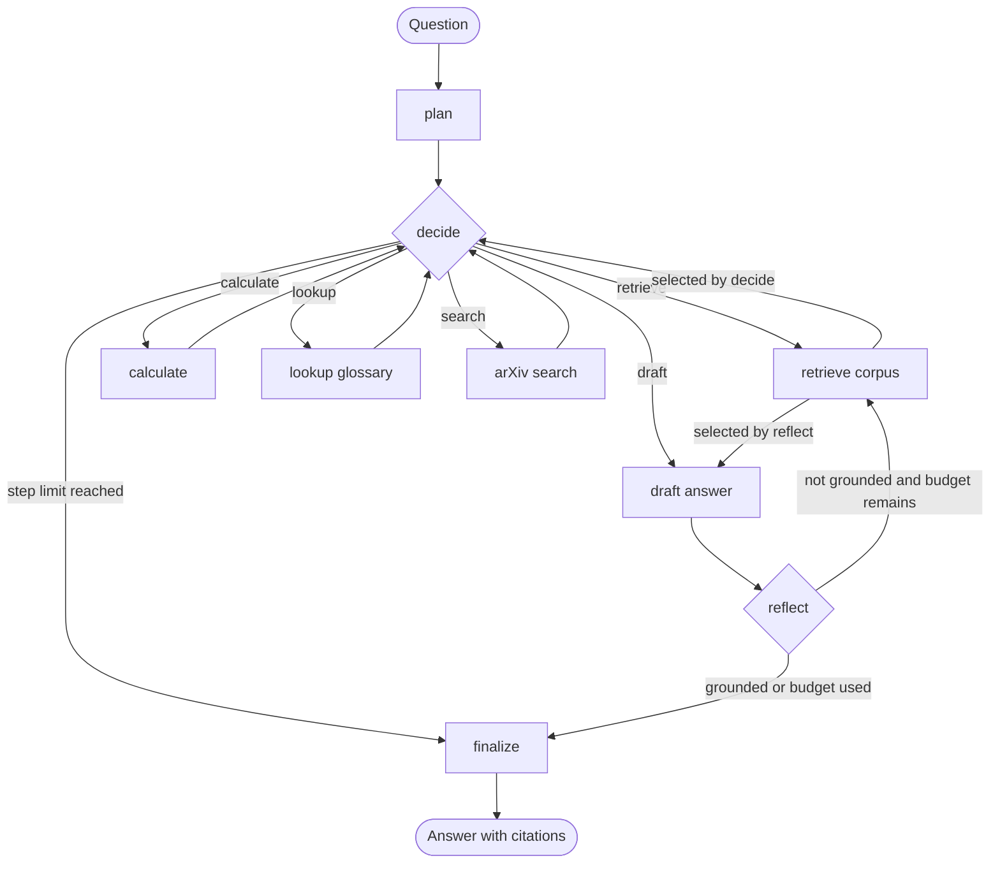

# Research RAG Agent

A local-first research assistant that ingests PDFs and notes, builds a semantic Chroma index, routes questions between corpus search and general answering, and returns source-aware answers.

**Primary demonstration:** local document ingestion, PDF extraction, chunking, embeddings, semantic retrieval, routing, citations, and a document-retrieval check.

## What I Built

Research documents are often difficult to search consistently. This project turns a local folder of PDFs, Markdown, and text notes into a searchable research corpus without uploading the documents to a hosted vector database.

The system demonstrates an end-to-end RAG workflow:

```text
Local files -> PDF/text extraction -> page-aware chunks -> local embeddings
    -> persistent Chroma index -> semantic retrieval -> routed answer
```

The included sample corpus uses two public NIST AI publications. Private or unpublished documents can be placed in the same local folder and remain outside Git.

## Key Features

- Recursive ingestion of `.pdf`, `.md`, and `.txt` files
- Page-aware PDF extraction with source metadata
- Overlapping character-based chunking
- Local Sentence Transformers embeddings
- Persistent Chroma vector database with cosine similarity
- Rule-based `CORPUS_SEARCH` versus `GENERAL_ANSWER` routing
- Top-k retrieval with document and page citations
- Extractive fallback when no LLM endpoint is configured
- LangGraph document agent that plans, chooses tools, checks groundedness, and stops at a step limit
- Optional OpenAI-compatible generation through Hugging Face, OpenAI, or a local server
- Five-question informal retrieval evaluation
- CLI and optional Streamlit interface
- Local-only corpus policy suitable for private research notes

## Architecture



### Data flow

1. `scripts/download_public_corpus.py` optionally downloads the public sample files.
2. `src/ingest.py` finds supported files recursively and preserves PDF page boundaries.
3. `src/chunker.py` creates overlapping chunks.
4. `src/embeddings.py` generates normalized local embeddings.
5. `src/vector_store.py` persists chunks and metadata in Chroma.
6. `src/router.py` chooses the query route.
7. `src/pipeline.py` retrieves context, calls the configured LLM, or uses the local fallback.
8. `evaluation/evaluate.py` measures whether the expected source document appears in the unique top-k results.

## Technology Stack

| Area | Technology | Purpose |
| --- | --- | --- |
| Language | Python 3.10+ | Application and CLI orchestration |
| PDF extraction | PyPDF | Page-level text extraction |
| Embeddings | Sentence Transformers | Local semantic representations |
| Vector database | Chroma | Persistent local similarity search |
| Generation | OpenAI-compatible HTTP API | Optional answer generation |
| Agent graph | LangGraph | Plan, tool routing, reflection, and step limit |
| Tool server | MCP Python SDK | Optional stdio server for the same tools |
| Evaluation | Pytest and custom evaluator | Deterministic tests and retrieval check |
| Interface | argparse and Streamlit | CLI and optional browser UI |

The default embedding model is `sentence-transformers/all-MiniLM-L6-v2`. The first run downloads model weights and works on CPU; a GPU is optional, not required.

## Repository Structure

```text
research-rag-agent/
├── README.md
├── requirements.txt
├── .env.example
├── app.py                         # Optional Streamlit UI
├── diagrams/architecture.mmd      # Mermaid architecture source
├── diagrams/agent_graph.mmd      # LangGraph control flow
├── evaluation/
│   ├── agent_eval.py              # Plain RAG versus LangGraph comparison
│   ├── agent_questions.json       # Six fixture questions with expected facts
│   ├── evaluate.py                # Informal top-k source evaluation
│   ├── fixtures/                  # Short notes used by the agent comparison
│   └── questions.json             # Five corpus-grounded questions
├── scripts/
│   └── download_public_corpus.py  # Recreates the public sample corpus
├── .github/workflows/ci.yml       # Runs the test suite
├── src/
│   ├── agent/                     # LangGraph document agent, tools, and MCP server
│   ├── chunker.py                 # Overlapping text chunks
│   ├── embeddings.py              # Local embedding model wrapper
│   ├── generator.py               # LLM client and extractive fallback
│   ├── ingest.py                  # File discovery, extraction, indexing
│   ├── main.py                    # CLI entry point
│   ├── pipeline.py                # Routing, retrieval, and answering
│   ├── retriever.py               # Small deterministic ranking utility
│   ├── router.py                  # Query route classifier
│   └── vector_store.py            # Chroma persistence and queries
├── tests/                         # Unit and edge-case tests
├── data/corpus/                   # Local documents; the whole tree is gitignored
└── chroma_db/                     # Generated index; the whole tree is gitignored
```

## Setup

### Requirements

- Python 3.10 or newer
- CPU: sufficient for the sample corpus; GPU is optional
- Approximately 1 GB of free disk space for Python dependencies and first-run model caches
- Internet access only for dependency/model downloads and optional hosted LLM calls

Create an environment and install dependencies:

```powershell
python -m venv .venv
.venv\Scripts\Activate.ps1
python -m pip install -r requirements.txt
Copy-Item .env.example .env
```

On macOS/Linux, use `source .venv/bin/activate` and `cp .env.example .env`.

### Configuration

`.env` is local-only and ignored by Git.

| Variable | Default | Description |
| --- | --- | --- |
| `LLM_API_KEY` | empty | Token for the selected OpenAI-compatible provider |
| `LLM_BASE_URL` | `https://router.huggingface.co/v1` in the template | Chat completions endpoint |
| `LLM_MODEL` | `Qwen/Qwen2.5-7B-Instruct` | Generation model identifier |
| `EMBEDDING_MODEL` | `sentence-transformers/all-MiniLM-L6-v2` | Local embedding model |
| `CHROMA_PATH` | `./chroma_db` | Local vector database path |
| `COLLECTION_NAME` | `research_corpus` | Chroma collection name |
| `AGENT_LLM_BACKEND` | `mock` in the template | `mock`, `openai`, or `auto` |
| `AGENT_MAX_STEPS` | `6` | Maximum decision steps before the agent finalizes |
| `AGENT_MAX_REFLECTIONS` | `1` | Extra retrievals allowed when a draft is not grounded |
| `AGENT_WEB_SEARCH` | `0` | Set to `1` to let the search tool call the public arXiv API |

The Hugging Face route requires a free access token with inference permission and is subject to provider credits and rate limits. OpenAI, LM Studio, Ollama, llama.cpp, and other OpenAI-compatible services can be used by changing `LLM_BASE_URL` and `LLM_MODEL`.

No LLM credential is required for corpus retrieval: when generation is unavailable, the project returns an explicitly labelled extractive answer from the retrieved context. General questions require a configured generation endpoint.

## Reproducible Demo

### 1. Download the public sample corpus

```powershell
python scripts/download_public_corpus.py
```

The script downloads two official NIST publications into the ignored `data/corpus/papers/` directory. Review the source publication terms before redistributing downloaded files.

### 2. Build the local index

```powershell
python -m src.main ingest --reset
```

Expected local run characteristics are approximately 3 documents including the corpus README, 113 extracted pages, and page-aware chunks. Counts can change if the corpus changes.

### 3. Ask a corpus question

Use explicit corpus wording so the rule-based router selects retrieval:

```powershell
python -m src.main query "According to the local NIST research documents, what are the four core functions of the AI Risk Management Framework?"
```

The command prints the selected route, reason, retrieved source/page metadata, and either an LLM-generated answer or a labelled local extractive fallback.

### 4. Run the retrieval evaluation

```powershell
python -m src.main evaluate
```

The evaluator checks five questions and reports whether the expected document appears among the unique top-k retrieved documents. It does not claim generation quality or factual correctness.

### 5. Optional Streamlit UI

```powershell
python -m streamlit run app.py
```

## Example Output

A verified corpus-search run reports the route and page-specific sources in this shape:

```text
ROUTE
-----
Route: CORPUS_SEARCH
Reason: The query refers to information expected to exist in the local research corpus.

Retrieved sources:
1. NIST.AI.100-1.pdf — page 25
2. NIST.AI.100-1.pdf — page 8
3. NIST.AI.100-1.pdf — page 8

Answer:
LLM unavailable; answer extracted from retrieved context: ...
```

With a working LLM endpoint, the answer section is generated from the retrieved context and the same source list is retained.

## Agent (LangGraph)

The plain pipeline routes with rules and then retrieves or calls the generator. The document agent is a separate LangGraph state graph. It plans, chooses a tool, drafts from the tool evidence, and checks that the draft is grounded before it returns citations.



### Quickstart

The default backend does not call a model and does not need an API key:

```powershell
python -m evaluation.agent_eval
python -m src.main agent "Calculate 7 / 40 * 100."
python -m src.main agent "Look up the glossary entry for Map."
python -m src.agent.mcp_server
```

`agent-eval` compares plain extractive RAG with the agent on six fixture questions. `agent` runs one question. After `python -m src.main ingest`, a corpus question uses the Chroma index. The calculator, glossary, and disabled-search paths do not need that index. `python -m src.agent.mcp_server` serves the same four tools over stdio.

To use a local OpenAI-compatible server instead of the mock:

```text
AGENT_LLM_BACKEND=openai
LLM_BASE_URL=http://localhost:11434/v1
LLM_MODEL=llama3.2
LLM_API_KEY=
```

A hosted model uses the same `openai` backend with `LLM_API_KEY`, `LLM_BASE_URL`, and `LLM_MODEL`. `AGENT_LLM_BACKEND=auto` selects that client only when a key is set or the base URL points at localhost. Otherwise it stays on the mock.

Set `AGENT_WEB_SEARCH=1` before asking an arXiv question. The default is off, and the search tool then returns a disabled message without contacting the network.

A verified calculator run looks like this:

```text
PLAN
----
Plan: calculate, then draft, then reflect. Keep the answer tied to tool evidence.

TRACE
-----
plan -> decide -> calculate -> decide -> draft -> reflect -> finalize
Steps: 2 / 6
Reflections: 0
Grounded: True (groundedness=1.00; threshold=0.50; accepting the draft)

Tool calls:
1. calculate {'expression': '7 / 40 * 100'}

Answer:
7 / 40 * 100 = 17.5

Citations:
- calculator
```

On the fixture notes, the core-functions question takes the path `plan -> decide -> retrieve -> decide -> draft -> reflect -> finalize` and answers with the sentence that names Govern, Map, Measure, and Manage, cited as `risk_functions.md — page 1`.

### Design decisions

- The graph is an explicit `StateGraph` in `src/agent/graph.py`. Routing is a node that returns one action: `retrieve`, `calculate`, `lookup`, `search`, `draft`, or `finalize`. Tool nodes write evidence, then either return to `decide` or, when reflection asked for another passage, go straight back to `draft`.
- The default chat backend is deterministic. It emits the same action schema the hosted backend is prompted to return as JSON. If a hosted response is not valid JSON, `decide` falls back to that policy. Tests and the comparison use the mock, so they do not need a paid key or a running model server.
- Tools are the corpus retriever, an AST calculator that rejects names and large exponents, a small glossary, and arXiv search behind `AGENT_WEB_SEARCH`. The CLI retriever is the existing Chroma store. Tests and `agent-eval` use the in-memory overlap ranker and keep only passages tied for the best score, so a three-note fixture does not dump every note into the answer.
- Reflection scores the draft, not the citation block. The score is the fraction of non-stopword draft tokens that also appear in tool evidence. The threshold is 0.5. Below that, and only when both `AGENT_MAX_REFLECTIONS` and `AGENT_MAX_STEPS` still have room, the graph retrieves again with a shorter query and drafts once more. Otherwise it finalizes.
- `max_steps` counts tool-selection decisions. A reflection retry consumes a step too. At the limit, `decide` stops calling tools and finalizes from the evidence already collected.

### Measured comparison

Command: `python -m evaluation.agent_eval`

One pass on Python 3.12.3, Linux, mock backend, lexical retriever, graph compiled once before the questions were timed. No API calls. Latency is wall-clock for that pass and will differ on another machine. Accuracy, tool choice, groundedness, and reflection count are deterministic for this backend and fixture set.

Accuracy means every expected fact substring is present. Groundedness is the same token-overlap score used above, applied to the final answer string, so citation labels that are not in the passage text lower the agent score. Plain RAG's only tool call is one retrieval. The agent made one tool call on each question. Reflection retried zero times, because each mock draft quoted tool evidence and cleared the 0.5 threshold. The reflection score on the draft, before citations were appended, was 1.00 on the verified calculator, glossary, and fixture-document runs.

| System | Correct | Accuracy | Mean groundedness | Mean tool calls | Mean latency (ms) |
| --- | ---: | ---: | ---: | ---: | ---: |
| Plain extractive RAG | 3/6 | 0.500 | 0.667 | 1.000 | 0.077 |
| LangGraph agent | 6/6 | 1.000 | 0.833 | 1.000 | 2.383 |

| Question | Plain correct | Agent correct | Agent tool | Plain groundedness | Agent groundedness | Plain ms | Agent ms |
| --- | --- | --- | --- | ---: | ---: | ---: | ---: |
| core-functions | yes | yes | retrieve | 1.000 | 0.867 | 0.180 | 3.890 |
| generative-risks | yes | yes | retrieve | 1.000 | 0.889 | 0.060 | 2.127 |
| trustworthy | yes | yes | retrieve | 1.000 | 0.864 | 0.079 | 1.959 |
| percentage | no | yes | calculate | 0.000 | 0.600 | 0.030 | 2.107 |
| glossary-map | no | yes | lookup | 1.000 | 0.778 | 0.071 | 2.204 |
| arxiv-disabled | no | yes | search | 0.000 | 1.000 | 0.039 | 2.011 |

Plain RAG answered the three note questions and missed the calculation, the glossary definition, and the disabled-search message. On `glossary-map` its groundedness was still 1.000: it quoted a retrieved note that mentions Map, and that note does not contain the glossary sentence, so the answer was not counted correct. The agent called `calculate`, `lookup`, or `search` for those three questions. With `AGENT_WEB_SEARCH` left at `0`, the search tool did not open a network connection.

This comparison does not replace the NIST top-k retrieval check below. The NIST PDFs are not in Git, and these six questions are the committed fixtures.

## Evaluation

The 5/5 top-3 result below is document retrieval only. It is not answer quality.

The five questions name NIST source documents: `NIST.AI.100-1.pdf` (AI Risk Management Framework) and `NIST.AI.600-1.pdf` (Generative AI Profile). A hit means only that the named document appears among the unique top-3 retrieved documents. The check does not score the written answer, faithfulness, citation correctness, latency, or language quality.

On the local NIST sample corpus, the verified retrieval result was:

```text
Questions: 5
Top-3 document hits: 5/5
Top-3 document retrieval rate: 100%
```

That 5/5 score means every question retrieved its expected NIST document in the top 3. It does not mean the generated or extractive answers were correct. The PDFs and Chroma database are not stored in Git, so a fresh clone must download the corpus and rebuild the index before running the evaluation.

## Technical Highlights

- Designed a local-first RAG pipeline that keeps research files on disk.
- Implemented page-aware PDF provenance instead of assigning every chunk to page 1.
- Added collision-resistant chunk identifiers that include document path, page, and chunk position.
- Integrated a persistent Chroma store with explicit empty-index and `top_k` validation.
- Added a transparent extractive fallback so corpus retrieval remains demonstrable without paid inference.
- Kept hosted generation configurable through a standard OpenAI-compatible interface.
- Added a LangGraph document agent with tool routing, a lexical groundedness check, a step limit, and a deterministic backend for tests.
- Added regression tests for chunking, routing, PDF page boundaries, vector-store edge cases, and the agent graph.
- Added a reproducible public-corpus download script without committing downloaded documents.

## Limitations and Trade-offs

- The plain router is intentionally rule-based and may misclassify ambiguous questions.
- The agent's default backend is a deterministic policy, not a generative model. It is there so the graph, tools, and evaluation run without an API key. A local or hosted model is optional and was not part of the measured comparison.
- The groundedness check is lexical overlap. A paraphrased answer can fall below the threshold, and a quoted but off-topic passage can score as grounded.
- arXiv search is off unless `AGENT_WEB_SEARCH=1`. The comparison measured the disabled path only.
- Character-based chunks are simple and predictable but may split concepts or tables.
- PDF extraction can lose layout, tables, and scanned-document content.
- The extractive fallback is a transparent resilience path, not a replacement for a generative model.
- The NIST retrieval check has five questions and scores document retrieval, not answer quality. The agent comparison has six fixture questions and scores fact substrings plus lexical overlap.
- The project does not provide authentication or multi-user isolation for the optional Streamlit UI.
- A remote LLM endpoint may receive retrieved document context; use a trusted provider and avoid sending sensitive material unintentionally.

## Troubleshooting

**`NO_CORPUS` during ingestion**  
Place `.pdf`, `.md`, or `.txt` files under `data/corpus/`, or run the public download script first.

**The first run is slow**  
Sentence Transformers downloads model weights and initializes them locally. Later runs reuse the local cache.

**The answer says `LLM unavailable`**  
Retrieval still worked. Add `LLM_API_KEY` and confirm `LLM_BASE_URL` and `LLM_MODEL` in `.env`, or use the extractive fallback for corpus questions.

**The answer says `LLM_API_KEY is missing`**  
The configured endpoint is remote. Add a token locally; never put it in GitHub or in chat.

**Chroma results look stale**  
Rebuild the local index after changing documents or embedding settings:

```powershell
python -m src.main ingest --reset
```

**A private document must not be published**  
Keep it under `data/corpus/`. The directory contents and generated Chroma files are ignored by Git. Check `git status --ignored` before staging.

## How to Walk Through the Project

1. Start with the one-sentence description and show the architecture diagram.
2. Open `src/ingest.py` and explain local file discovery, PDF page extraction, chunking, metadata, and Chroma persistence.
3. Run `python scripts/download_public_corpus.py` and `python -m src.main ingest --reset`.
4. Run the corpus query and point out `CORPUS_SEARCH`, retrieved pages, and source citations.
5. Open `src/pipeline.py` and explain the separation between routing, retrieval, generation, and the extractive fallback.
6. Run `python -m src.main evaluate` and clarify that the `100%` result measures document-level top-three retrieval only.
7. Open `src/agent/graph.py` and walk the plan, decide, tool, reflect, and finalize nodes. Run `python -m src.main agent "Calculate 7 / 40 * 100."` and point at the trace.
8. Run `python -m evaluation.agent_eval` and read the accuracy, groundedness, tool-call, and latency numbers as one measured pass of the mock backend on the fixture questions.
9. Discuss why private documents and generated indexes are excluded from GitHub.
10. Discuss limitations: heuristic routing, PDF layout loss, lexical groundedness, the mock backend, the small evaluation sets, and dependence on the selected LLM provider when one is configured.
11. Close with improvements such as hybrid retrieval, reranking, citation verification, and a larger benchmark.

## Project Information

This project is a local-first retrieval-augmented generation system. The implementation emphasizes understandable Python modules, reproducible commands, explicit limitations, and privacy-conscious handling of research documents.

The code, tests, and documentation are intended for public GitHub publication and are licensed under the MIT License. Downloaded third-party documents retain their own terms.

## License

This project is licensed under the MIT License. See [LICENSE](LICENSE) for details.
